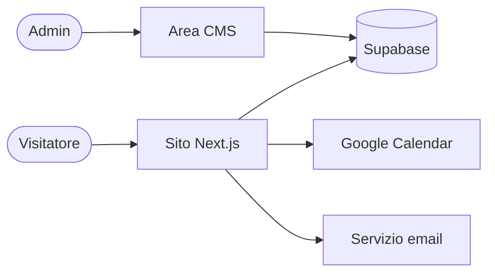

  

<a href="README.md">🇬🇧 English</a> · <b>🇮🇹 Italiano</b>

  
  

> [!NOTE]
> Questo repository è una **vetrina del progetto**: il codice sorgente è privato. Una demo è disponibile su richiesta.

## 🧭 Panoramica

Sito web e **sistema di gestione dei contenuti** per il Dott. Calogero Romano, agronomo consulente: un sito pubblico per presentare servizi e lavori svolti, prenotazione online degli appuntamenti, un blog e un'area riservata in cui il cliente gestisce tutto senza toccare il codice.

*Progetto per un cliente.*

## ✨ Funzionalità principali

- 🌿 **Sito pubblico**: servizi, portfolio dei lavori, blog, pagine legali
- 📅 **Prenotazione online** sincronizzata con Google Calendar
- ✉️ **Email automatiche** di conferma delle prenotazioni
- 📝 **CMS con editor di testo** per scrivere e pubblicare articoli e lavori
- 🔐 **Area admin** con autenticazione
- 🍪 **Pronto per il GDPR**: banner dei cookie e pagine legali
- 🧪 **Modalità mock**: tutto il sito gira in locale senza servizi esterni, per sviluppo e demo veloci

## 🏗️ Architettura

## 🧰 Tecnologie

## 📬 Contatti

Realizzato da **Salvatore Cutaia**, ingegnere informatico specializzato in agenti AI e automazioni.

