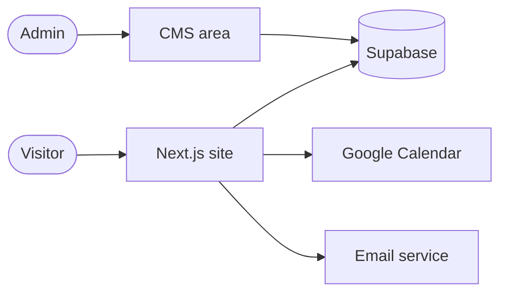

  

<b>🇬🇧 English</b> · <a href="README.it.md">🇮🇹 Italiano</a>

  
  

> [!NOTE]
> This repository is a **project showcase**: the source code is private. A demo is available on request.

## 🧭 Overview

Website and **content management system** for Dr. Calogero Romano, agronomist consultant: a public site to present services and past work, online appointment booking, a blog, and an admin area where the client manages everything without touching code.

*Client project.*

## ✨ Key features

- 🌿 **Public site**: services, portfolio of past works, blog, legal pages
- 📅 **Online booking** synced with Google Calendar
- ✉️ **Transactional emails** for booking confirmations
- 📝 **Rich-text CMS** to write and publish blog posts and works
- 🔐 **Admin area** with authentication
- 🍪 **GDPR-ready**: cookie banner and legal pages
- 🧪 **Mock mode**: the whole site runs locally without any external service, for fast development and demos

## 🏗️ Architecture

## 🧰 Tech stack

## 📬 Contact

Built by **Salvatore Cutaia**, Computer Engineer specialized in AI agents & automations.

